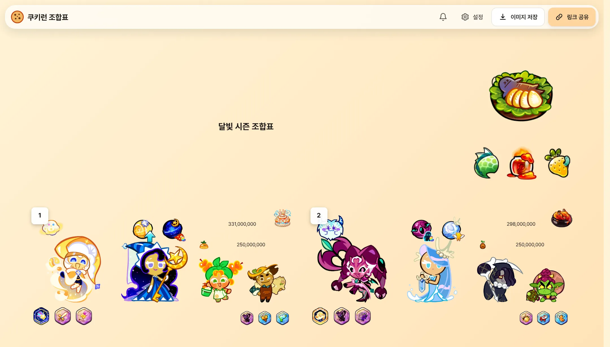
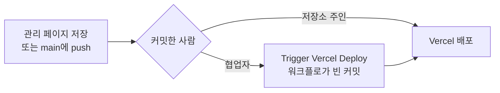

<div align="center">


# 쿠키런: 오븐브레이크 조합표 생성기

**12개 아레나 조합표를 만들고, 이미지로 저장하거나 짧은 링크로 공유하세요.**

[사이트 열기](https://cookie-run-combination-generator.vercel.app) &nbsp;|&nbsp; [아이템 추가하기](#아이템-추가하기) &nbsp;|&nbsp; [데이터 관리 페이지](#데이터-관리-페이지) &nbsp;|&nbsp; [개발](#개발)




</div>

## 주요 기능

- **조합표 편집**: 시즌명, 시즌 요리와 재료, 아레나마다 메인과 대체 조합(펫, 쿠키, 보물, 마법사탕, 축복, 요리, 최고점, 유튜브 링크)
- **이미지 저장**: 어떤 기기에서 저장해도 같은 크기와 비율(2열)의 이미지
- **짧은 링크 공유**: `https://…/s/a1B2c3D4e5` 형태. 예전 긴 링크(`?data=`)도 계속 열림
- **꾸미기 설정**: 배경(단색, 그라데이션, 이미지), 글꼴, 글자 정렬과 위치, 점수 표기(콤마, 억 만, K M B), 카드와 여백. 조합표를 보면서 바로 조정
- **어디서나 같은 배치**: PC, 태블릿, 휴대폰 가로와 세로 모두 같은 비율로 확대, 축소
- **업데이트 소식**: 새 아이템이 올라가면 자동으로 소식이 만들어지고, 다시 방문한 사용자에게 한 번 보여줌
- **접근성**: 모든 칸을 키보드로 조작, 스크린리더 지원, 명도 대비 WCAG AA

## 아이템 추가하기

새 쿠키, 펫, 보물 등은 **이미지 파일만 올리면** 사이트에 나타납니다. 방법은 두 가지입니다.

| 방법 | 이런 분께 | 반영 |
|---|---|---|
| [데이터 관리 페이지](#데이터-관리-페이지) | Git이 익숙하지 않은 관리자 | 저장 후 1~3분 |
| [저장소에 직접 올리기](#저장소에-직접-올리기) | Git으로 작업하는 개발자 | main에 올린 후 1~3분 |

> [!NOTE]
> 아이템 목록(`public/data/gameData.json`)과 작은 미리보기 이미지는 빌드할 때 자동으로 만들어집니다. 직접 고치거나 커밋하지 않습니다.

### 데이터 관리 페이지

관리자에게만 알려 준 주소에서 GitHub로 로그인하면, 화면에서 바로 데이터를 관리할 수 있습니다.

- 아이템 추가 (여러 장 한 번에, 파일 이름이 아이템 이름)
- 이름 바꾸기, 등급 옮기기, 이미지 바꾸기, 삭제
- 숨기기, 맨 앞에 고정, 검색용 다른 이름, 설명
- 업데이트 소식 쓰기
- 모든 종류에서 한 번에 검색

바꾼 내용은 아이템 칸에 "변경 예정", "삭제 예정"으로 표시되고, 저장 전에 하나씩 되돌릴 수 있습니다. **저장** 한 번으로 main에 커밋 1개로 올라가고, 1~3분 뒤 사이트에 반영됩니다. 커밋 작성자는 로그인한 관리자 본인입니다. 저장 중에 로그인이 끝나도 바꾼 내용은 그대로 남아 있어서, 다시 로그인한 뒤 이어서 저장할 수 있습니다.

> [!IMPORTANT]
> 저장소에 **Write 이상 권한**이 있는 GitHub 계정만 들어올 수 있습니다. 함께 관리할 사람은 저장소 Settings → Collaborators에서 초대해 주세요. 권한을 빼면 다음 요청부터 바로 막힙니다.

<details>
<summary><b>처음 한 번 설정하기 (저장소 관리자)</b></summary>

1. **GitHub OAuth 앱 만들기**: GitHub → Settings → Developer settings → OAuth Apps → New OAuth App
   - Homepage URL: `https://cookie-run-combination-generator.vercel.app`
   - Authorization callback URL: `https://cookie-run-combination-generator.vercel.app/api/studio/callback`
   - 만든 뒤 **Generate a new client secret**
2. **Vercel 환경변수 추가**: Vercel 프로젝트 → Settings → Environment Variables (Production)

   | 이름 | 값 |
   |---|---|
   | `STUDIO_PATH` | 관리 페이지 주소. 영문, 숫자, `-`, `_` 8자 이상으로 추측하기 어렵게 (예: `k7q-room-2x91`) |
   | `GITHUB_CLIENT_ID` | OAuth 앱의 Client ID |
   | `GITHUB_CLIENT_SECRET` | OAuth 앱의 Client secret |
   | `STUDIO_SESSION_SECRET` | 32자 이상 무작위 문자열 (`openssl rand -base64 32`) |

3. **다시 배포**하면 `https://cookie-run-combination-generator.vercel.app/<STUDIO_PATH>` 에서 열립니다.

> [!WARNING]
> 위 값들은 비밀입니다. 저장소의 `.env`에 적지 말고 Vercel 환경변수(로컬에서는 `.env.local`)에만 넣어 주세요. 관리 페이지 주소도 저장소나 공개된 곳에 적지 않습니다.

</details>

<details>
<summary><b>보안 방식</b></summary>

- 환경변수로 정한 주소에서만 열립니다. 주소는 저장소에도, 사이트의 공개 파일에도 남지 않고 검색엔진 수집도 막혀 있습니다.
- 로그인 정보는 서버에서만 읽을 수 있는 암호화 쿠키(8시간)에 담기고, 요청마다 저장소 쓰기 권한을 다시 확인합니다.
- 다른 사이트에서 보낸 저장 요청은 거절하고, 로그아웃하면 GitHub 토큰도 폐기합니다.
- 올린 이미지는 파일 내용으로 형식(PNG, JPG, WEBP)을 확인하고, 크기와 이름, 저장 경로를 서버에서 다시 검사합니다.
- GitHub 권한은 공개 저장소에 커밋하는 데 필요한 `public_repo`만 요청합니다.

</details>

#### 내 컴퓨터에서 쓰기 (로컬 모드)

GitHub 로그인 없이, 저장하면 **프로젝트 폴더의 파일이 바로 바뀌는** 방식입니다. 바뀐 파일을 확인한 뒤 직접 커밋하고 푸시하면 사이트에 반영됩니다.

1. 프로젝트 폴더의 `.env.local`에 `STUDIO_LOCAL=1`을 적습니다.
2. `npm run dev`로 띄운 뒤 `http://localhost:3000/studio-local`을 엽니다.
3. 저장하면 `public/images/`, `data/item-meta.json`, `data/updates.json`이 바뀌고, 아이템 목록과 작은 이미지도 바로 다시 만들어져 `http://localhost:3000`에서 확인할 수 있습니다.

> [!NOTE]
> 로컬 모드는 `npm run dev`(개발 서버)에서만 켜지고, 이 컴퓨터에서 연 요청(`localhost`)만 받습니다. 배포된 사이트에서는 `STUDIO_LOCAL`이 있어도 꺼져 있습니다.

### 저장소에 직접 올리기

이미지를 아래 폴더에 넣고 main에 올립니다.

| 종류 | 폴더 | 등급 폴더 |
|---|---|---|
| 쿠키 | `public/images/cookies/` | 필요 |
| 펫 | `public/images/pets/` | 필요 |
| 보물 | `public/images/treasures/` | 필요 |
| 마법사탕 | `public/images/magic_candies/` | 필요 |
| 요리 | `public/images/dishes/` | 없음 |
| 재료 | `public/images/ingredients/` | 없음 |
| 축복 | `public/images/blessings/` | 없음 |

- 등급 폴더: `legendary`, `epic`, `rare`, `common`
- **파일 이름이 곧 사이트에 보이는 이름**입니다. 예: `public/images/cookies/epic/파김치.png` → "파김치"
- 형식은 PNG(권장), JPG, WEBP. 1MB 이하를 권장합니다.
- 새 쿠키는 보통 쿠키, 마법사탕, 펫 세 폴더에 **같은 이름**으로 넣습니다.

<details>
<summary><b>추가 정보: <code>data/item-meta.json</code></b></summary>

이름으로 지정하며, 같은 이름이면 쿠키, 마법사탕, 펫 모두에 적용됩니다.

```jsonc
{
  "pinned": ["빈배경", "공사중"],            // 선택 창 맨 앞에 고정
  "added": {},                                // (보통 비워 둠) 추가 날짜를 Git 기록 대신 직접 정할 때만
  "aliases": { "브레이브 로드": ["브로"] },   // 검색용 다른 이름
  "descriptions": { "lv1": "설명 문구" },     // 선택 창에 보이는 설명
  "hidden": [],                               // 파일은 두고 목록에서만 숨기기
  "renamed": { "옛 이름": "새 이름" }          // 파일 이름을 바꿨을 때
}
```

실제 파일은 주석을 쓸 수 없는 JSON입니다.

</details>

> [!TIP]
> 파일 이름을 바꿀 때(오타 수정 등)는 `renamed`에 `"옛 이름": "새 이름"`을 추가하면 예전에 저장하거나 공유한 조합표도 새 이미지로 이어집니다. 등급 폴더만 옮긴 경우는 자동으로 이어집니다. 데이터 관리 페이지에서 이름을 바꾸면 이 작업도 자동으로 됩니다.

#### 업데이트 소식

새 이미지가 올라가면 빌드할 때 Git 기록에서 처음 추가된 날짜를 읽어 "쿠키 추가: ○○" 같은 소식을 **자동으로** 만듭니다. 새 아이템에는 30일 동안 NEW 배지가 붙습니다.

- 같은 이름의 쿠키, 펫, 마법사탕은 쿠키 한 줄로 묶입니다.
- 한 날짜에 40개보다 많이 추가된 일괄 작업은 소식에서 뺍니다.
- 기능 변경 같은 다른 소식은 `data/updates.json`에 씁니다. `·`, `ㅡ` 같은 기호 대신 쉼표나 문장으로 써 주세요.

```json
[{ "date": "2026-11-10", "title": "기능 개선", "items": ["설정에 카드 꾸미기 추가"] }]
```

> [!NOTE]
> Vercel은 기본적으로 최근 커밋 일부만 받아서 빌드합니다. 오래된 소식까지 모두 보이게 하려면 Vercel 환경변수에 `VERCEL_DEEP_CLONE=true`를 추가하세요.

#### 검사

```bash
npm run check:content
```

- **오류**: 고쳐야 배포됩니다. 예) 등급 폴더 이름 오타, 지원하지 않는 형식, `renamed`의 새 이름 파일이 없음, JSON 문법 오류
- **경고**: 사이트는 동작합니다. 예) 쿠키와 같은 이름의 펫이나 마법사탕이 없음, `item-meta.json`에 적은 이름의 파일이 없음

PR이나 main 이외의 브랜치에 올리면 **검사** 워크플로가 자동으로 실행됩니다. main 배포 때도 빌드 과정에서 검사하며, 오류가 있으면 배포되지 않고 이전 버전이 유지됩니다.

## 배포 흐름



Vercel 무료(Hobby) 플랜은 저장소 주인의 커밋만 배포하므로, 협업자가 올린 변경은 `.github/workflows/auto-deploy.yml`이 주인 이름으로 빈 커밋을 남겨 배포를 이어 줍니다.

## 개발

Node.js 20 이상이 필요합니다.

```bash
npm install
npm run dev            # http://localhost:3000
npm run build          # 프로덕션 빌드 (아이템 데이터 생성 포함)
npm run lint
npm run check:content  # 아이템 이미지와 메타데이터 검사
npm run design:lint    # DESIGN.md 형식과 명도 대비 검사
```

### 짧은 공유 링크 (Supabase)

1. Supabase 프로젝트에 `supabase/migrations/`의 SQL을 적용합니다.
2. `.env.example`을 참고해 `NEXT_PUBLIC_SUPABASE_URL`, `NEXT_PUBLIC_SUPABASE_PUBLISHABLE_KEY`를 설정합니다.

> [!NOTE]
> 저장소의 `.env`에 들어 있는 값은 브라우저에 공개되는 용도의 키입니다. 데이터는 RLS로 막혀 있고 `create_share`, `get_share` 두 함수로만 접근할 수 있으며, IP별 요청 수 제한이 걸려 있습니다. 설정이 없거나 연결에 실패하면 긴 링크로 대신 공유합니다.

### 디자인 기준

편집 화면의 색, 글꼴, 간격, 모서리, 컴포넌트 규칙은 [`DESIGN.md`](DESIGN.md)([google-labs-code/design.md](https://github.com/google-labs-code/design.md) 형식)가 원본입니다. 색을 바꿀 때는 DESIGN.md를 고친 뒤 `npm run design:tokens`를 실행하면 Tailwind 클래스(`bg-primary`, `text-ink` 등)에 반영됩니다.

조합표는 기준 크기(2열 1552px, 1열 764px)로 디자인돼 있고, 모든 크기를 `u(px)`로 지정해 화면 폭에 맞춰 통째로 확대, 축소합니다. 화면 폭이 1000px 이상이면 2열, 좁으면 1열로 보여줍니다.

### 프로젝트 구조

```
app/
  page.tsx                 편집 화면 (/s/:id 짧은 링크도 같은 화면)
  [slug]/page.tsx          데이터 관리 페이지 (STUDIO_PATH 주소, 로컬 모드면 /studio-local. 그 밖의 주소는 404)
  api/studio/              로그인, 데이터 조회, 저장(커밋, 로컬 모드면 프로젝트 폴더에 쓰기)
components/
  Editor.tsx               화면 전체 (데이터와 공유 링크 불러오기)
  Toolbar.tsx              도구 막대 (업데이트, 설정, 이미지 저장, 링크 공유)
  Header.tsx, ComboBlock.tsx, Slot.tsx   조합표
  ImageSelectModal.tsx     아이템 선택 창
  SettingsPanel.tsx        꾸미기 설정
  studio/                  데이터 관리 화면, 저장 전 변경 목록
  ui/                      버튼, 창, 아이콘
lib/
  board.ts                 배율 단위 u(), 배경과 카드 스타일
  items.ts                 아이템 조회, 예전 경로를 현재 아이템으로 연결
  share.ts                 짧은 링크
  exportImage.ts           이미지 저장 (html2canvas, 필요할 때만 불러옴)
  studio/                  데이터 관리 서버 로직 (GitHub 커밋, 로컬 모드, 검사)
store/useAppStore.ts       편집 상태 (브라우저에 자동 저장)
scripts/generateImageData.js   이미지 폴더 → 아이템 목록, 검사, 업데이트 소식
data/                      item-meta.json, updates.json
supabase/migrations/       짧은 링크 DB 구조
```
